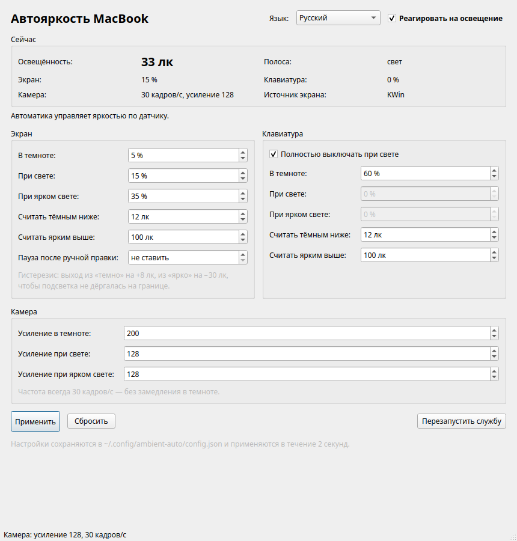

# Автояркость MacBook

Автоматическая регулировка яркости экрана, подсветки клавиатуры и настроек
камеры FaceTime HD по датчику освещённости MacBook Pro (ACPI `acpi-als`).
Демон systemd + графическое приложение на PyQt6. Пакет `.deb` для Debian/Ubuntu
и производных (проверено на KDE neon / Ubuntu 24.04).

[](https://github.com/marfffan/ambient-auto/actions/workflows/build.yml)



<sub>English UI — [screenshot-en.png](docs/screenshot-en.png), тёмный режим — [screenshot-dark.png](docs/screenshot-dark.png)</sub>

## Зачем это нужно

KDE Powerdevil умеет менять яркость по датчику только в некоторых сборках и
не управляет подсветкой клавиатуры MacBook. Эта программа делает всё сама:

- три полосы освещённости — **тёмно / свет / ярко**;
- независимые пороги и проценты яркости для экрана и клавиатуры;
- клавиатура полностью гаснет при любом свете (настраивается);
- камера никогда не замедляется: всегда 30 кадров/с, в темноте яркость
  добирается цифровым усилением;
- всё настраивается в приложении, без правки файлов и перезапуска службы;
- интерфейс на пяти языках, переключается прямо в окне и запоминается.

## Возможности

- Экран: по умолчанию 5 % в темноте, 15 % при свете, 35 % при ярком свете.
- Клавиатура: 60 % в темноте, 0 % при свете и при ярком свете.
- Камера: усиление 200 в темноте, 128 при свете; частота всегда 30 fps.
- Гистерезис на порогах, чтобы подсветка не дёргалась на границе.
- Автоматическое определение сеанса KDE и управление экраном через
  KWin/KScreen (KWin владеет подсветкой панели и перекрывает sysfs).
- Резервный режим: если KWin недоступен, яркость пишется напрямую в sysfs.
- Ручная правка яркости в панели KDE по умолчанию отменяется автоматикой
  (можно задать паузу до 60 минут).
- Служба переживает перезагрузку, вход в сеанс и перезапуск powerdevil.
- Настройки хранятся в `~/.config/ambient-auto/config.json` и переживают
  переустановку пакета.

## Установка

### Готовый пакет

Скачайте `ambient-auto_1.0.1_all.deb` со страницы
[Releases](https://github.com/marfffan/ambient-auto/releases) и установите:

```sh
sudo apt install ./ambient-auto_1.0.1_all.deb
```

Пакет сам:

- ставит демон и службу `ambient-auto.service`;
- включает и запускает её;
- создаёт конфиг для пользователя, запускавшего установку (или uid 1000);
- добавляет приложение «Автояркость MacBook» в меню.

Затем запустите приложение из меню («Настройки → Оборудование») или командой:

```sh
ambient-auto-gui
```

### Сборка из исходников

Нужны `dpkg-dev` и `python3`. Сборка не требует сети:

```sh
git clone https://github.com/marfffan/ambient-auto.git
cd ambient-auto
./build-deb.sh          # или make deb
sudo apt install ./build/ambient-auto_1.0.1_all.deb
```

## Как пользоваться

В верхней части окна — переключатель «Реагировать на освещение». Он полностью
включает и выключает автоматику: при выключении яркость и подсветка перестают
меняться, а управление остаётся за вами.

Ниже показано текущее состояние: освещённость в люксах, полоса, фактическая
яркость экрана, состояние клавиатуры и камеры, источник управления экраном.

| Полоса | Экран | Клавиатура | Камера |
| --- | --- | --- | --- |
| тёмно | 5 % | 60 % | усиление 200 |
| свет | 15 % | 0 % | усиление 128 |
| ярко | 35 % | 0 % | усиление 128 |

Пороги по умолчанию: «темно» ниже 12 лк, «ярко» выше 100 лк. Выход из полосы
происходит с гистерезисом (+8 лк из темноты, −30 лк из яркого света).
Пороги и проценты для экрана и клавиатуры задаются независимо.

Изменения применяются в течение 2 секунд, перезапуск не нужен.

## Язык интерфейса

Язык выбирается в самом приложении — список в правой части заголовка окна.
Смена языка применяется сразу, перезапускать ничего не нужно.

Доступны: русский, английский, немецкий, испанский, французский и пункт
«Системный» — он берёт язык из локали сеанса (`LANG`/`LC_ALL`), а при
неизвестной локали показывает английский.

Выбор хранится в конфиге ключом `language` и переживает перезапуск службы и
переустановку пакета. Название и описание приложения в меню KDE тоже
переводятся (`Name[ru]`, `Name[en]` и т. д. в desktop-файле).

Переводы лежат в `src/i18n.py` обычными словарями — чтобы добавить язык,
достаточно дописать словарь и строку в `LANGUAGES`, никакие `.ts`/`.qm` и
`lrelease` не нужны.

## Как это работает

| Устройство | Способ управления |
| --- | --- |
| Датчик | `/sys/bus/iio/devices/iio:device0/in_illuminance_input` |
| Экран | KWin/KScreen, `kscreen-doctor output.<выход>.brightness.<%>` |
| Клавиатура | `/sys/class/leds/smc::kbd_backlight/brightness` |
| Камера | модуль `facetimehd` (`ae_min_fps`) + V4L2-контрол `brightness` |

Демон работает от root (нужны sysfs и v4l2), сам находит активный сеанс KDE и
выполняет `kscreen-doctor` от имени пользователя через `runuser`. Состояние
пишется в `/run/ambient-auto/status.json`, его читает приложение.

Камера: драйвер `facetimehd` в темноте сам снижает частоту кадров, поэтому
демон жёстко задаёт `ae_min_fps=30`, а недостаток света компенсирует усилением.

## Настройки

Файл `~/.config/ambient-auto/config.json` (создаётся автоматически):

```json
{
  "enabled": true,
  "poll_seconds": 2.0,
  "manual_pause_minutes": 0,
  "language": "system",
  "screen": {
    "dark": 5, "normal": 15, "bright": 35,
    "dark_enter": 12, "dark_exit": 20,
    "bright_enter": 100, "bright_exit": 70
  },
  "keyboard": {
    "dark": 60, "normal": 0, "bright": 0,
    "dark_enter": 12, "dark_exit": 20,
    "bright_enter": 100, "bright_exit": 70
  },
  "camera": { "dark": 200, "normal": 128, "bright": 128, "fps": 30 }
}
```

| Ключ | Значение |
| --- | --- |
| `enabled` | включена ли автоматика |
| `poll_seconds` | период опроса датчика, секунды |
| `manual_pause_minutes` | пауза после ручной правки яркости в панели KDE (0 — не ставить) |
| `language` | язык интерфейса: `system`, `ru`, `en`, `de`, `es`, `fr` |
| `screen.*` / `keyboard.*` | проценты яркости для полос и пороги в люксах |
| `camera.*` | цифровое усиление по полосам; `fps` — частота кадров |

Правка файла вручную тоже работает: демон замечает изменения по mtime.

## Структура репозитория

```
src/ambient-auto          демон
src/gui.py                приложение (PyQt6)
src/i18n.py               переводы интерфейса
src/ambient-auto-gui      launcher
systemd/                  unit-файл службы
share/                    конфиг по умолчанию, desktop-файл, иконка
packaging/DEBIAN/         control и скрипты maintainer-а (шаблоны)
packaging/copyright       файл copyright для пакета
build-deb.sh, Makefile    сборка .deb
```

## Ограничения

- Нужен датчик освещённости MacBook (ACPI `acpi-als`); на другой технике
  программа не найдёт датчик и ничего не изменит.
- Управление экраном рассчитано на KDE Plasma 6 / Wayland (KWin, KScreen).
  Без KWin работает резервный режим через `/sys/class/backlight`.
- Пакет отвечает только за автоматику подсветки. Драйверы Wi-Fi (BCM4360),
  камеры FaceTime HD и их прошивки устанавливаются отдельно.
- Камера настраивается по порогам экрана (отдельных порогов для неё нет).

## Удаление

```sh
sudo apt remove ambient-auto
```

Личный конфиг в `~/.config/ambient-auto/` остаётся, чтобы настройки не
потерялись при переустановке. Удалить его можно вручную.

## Проверено

MacBook Pro 11,2 (15", Haswell), KDE neon User Edition (Ubuntu 24.04),
ядро 7.0.0, KDE Plasma 6, Wayland.

| Условие | Люкс | Экран | Клавиатура | Камера |
| --- | --- | --- | --- | --- |
| свет выключен | 0 | 5 % | 60 % (включена) | усиление 200, 30 fps |
| свет включён | 33 | 15 % | 0 % (погашена) | усиление 128, 30 fps |

## Лицензия

MIT, см. [LICENSE](LICENSE).

---

### English summary

Ambient-light automation for MacBook Pro on Linux: screen brightness via
KWin/KScreen, keyboard backlight and FaceTime HD camera via sysfs/V4L2.
systemd daemon + PyQt6 GUI, packaged as `.deb`. Tested on KDE neon 24.04.
